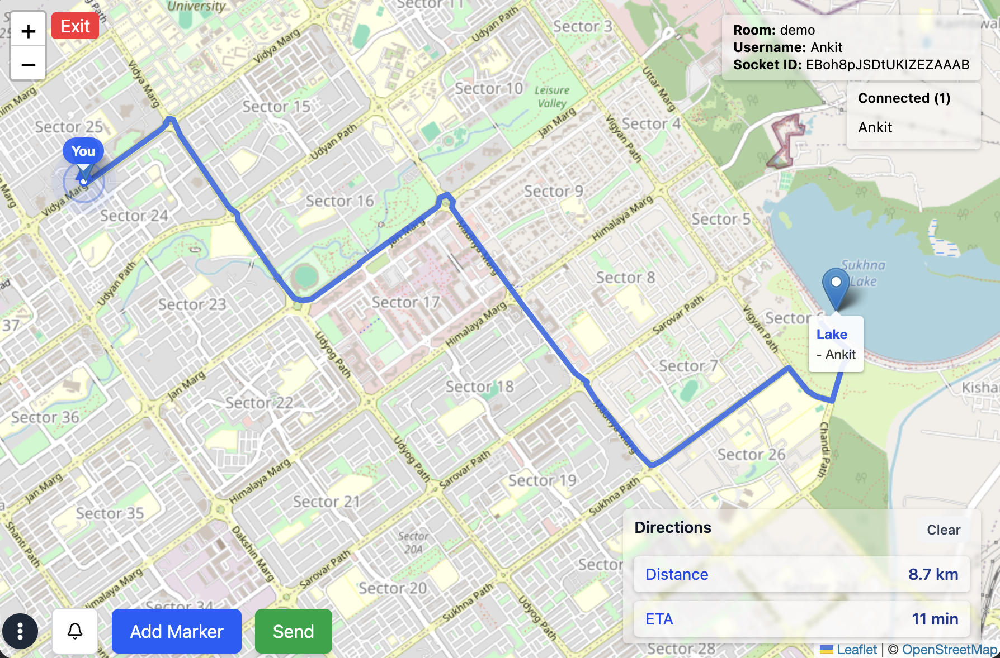

# Real-Time Group Location Sharing

A full-stack real-time collaborative location-sharing platform that enables multiple users to share their live locations, communicate through group chat, and collaborate on an interactive map.

Unlike traditional location-sharing solutions that primarily focus on one-to-one sharing, this project provides a shared workspace where every member of a group can view each other's live locations simultaneously, exchange messages, create map markers, and navigate collaboratively.



---

## Motivation

Most messaging applications support live location sharing, but they are primarily designed for individual conversations. Coordinating the real-time locations of an entire group often requires switching between multiple chats or relying on external tools.

This project addresses that limitation by providing a single collaborative map where participants can:

* Share their live location in real time
* View the live locations of all group members
* Communicate through an integrated group chat
* Create and share custom map markers
* Navigate to shared locations

The result is a collaborative mapping platform that simplifies group coordination for a wide range of real-world scenarios.

---

## Features

### Real-Time Location Sharing

* Share live GPS location with everyone in the room.
* View all participants moving on the map in real time.
* Instant synchronization using Socket.IO.

### Group Chat

* Room-based messaging with real-time delivery.
* Stay connected while tracking locations.

### Collaborative Map Markers

* Add custom markers anywhere on the map.
* Label important locations.
* Instantly synchronize markers across all connected users.

### Route Navigation

* Select any shared marker as a destination.
* Display the navigation route directly on the map.

### Room-Based Collaboration

* Create independent collaboration rooms.
* Optionally protect rooms with a password so only authorized users can join.
* Each room maintains its own members, chat, live locations, and map markers.

### Device Compass

* Uses the device orientation sensor to provide heading information during navigation.

---

## Potential Use Cases

The platform can be adapted for a variety of collaborative scenarios, including:

* Friends and family trips
* College or school excursions
* Trekking and hiking groups
* Cycling communities
* Event management
* Delivery coordination
* Disaster response and rescue teams
* Security and patrol teams
* Field survey operations

---

## Future Improvements

Planned enhancements include:

* Live speed indicator for participants
* Group voice calls
* Configurable deployments for organizations
* Photo attachments for map markers
* Marker notifications and activity history
* Progressive Web App (PWA) support
* Offline map caching
* User roles and permissions
* Analytics dashboard with route history and distance travelled

These improvements would allow the platform to evolve into a flexible collaborative mapping solution suitable for organizations, educational institutions, logistics providers, emergency response teams, and event coordinators.

# 🛠️ Tech Stack

## Frontend

| Technology              | Purpose                             |
| ----------------------- | ----------------------------------- |
| React.js                | Frontend framework                  |
| Socket.IO Client        | Real-time location and chat updates |
| React Leaflet + Leaflet | Interactive maps                    |
| Leaflet Routing Machine | Route generation and navigation     |
| Axios                   | REST API communication              |

---

## Backend

| Technology           | Purpose                 |
| -------------------- | ----------------------- |
| Node.js + Express.js | Backend API server      |
| Socket.IO            | Real-time communication |
| MongoDB + Mongoose   | Database and ODM        |
| JWT                  | Authentication          |

---

## APIs & Browser Features

- Geolocation API
- Device Orientation API (Compass)
- OpenStreetMap Tiles
- Leaflet Routing Machine

---

# 🏗️ System Architecture

The application follows a client-server architecture where REST APIs are responsible for authentication and persistent operations, while Socket.IO powers all real-time interactions such as location sharing, chat messages, and collaborative map updates.

```text
                        +-------------------------+
                        |      React Client       |
                        |-------------------------|
                        |  Authentication         |
                        |  Live Map              |
                        |  Group Chat            |
                        |  Marker Management     |
                        |  Navigation            |
                        +-----------+------------+
                                    |
                  REST APIs + Socket.IO
                                    |
                        +-----------v------------+
                        |     Express Server     |
                        |------------------------|
                        | REST Controllers       |
                        | Socket.IO Events       |
                        | Authentication         |
                        +-----------+------------+
                                    |
                             MongoDB Database
```

---

# 🔄 Application Workflow

```text
          User Opens Application
                     │
                     ▼
              User Authentication
                     │
                     ▼
                Join a Room
                     │
        ┌────────────┼────────────┐
        │            │            │
        ▼            ▼            ▼
  Share Location   Group Chat   Add Marker
        │            │            │
        └────────────┼────────────┘
                     ▼
            Socket.IO Server
                     ▼
      Broadcast Updates to Everyone
                     ▼
         Live Collaborative Map
```

---

# ⚙️ Key Features Overview

| Feature | Description |
|----------|-------------|
| Live Group Tracking | Share GPS location with all members in a room. |
| Group Chat | Real-time messaging powered by Socket.IO. |
| Shared Map Markers | Create collaborative markers visible to everyone. |
| Route Directions | Navigate to any marker using the shortest route. |
| Device Compass | Display the user's current heading for easier navigation. |
| Room-Based Collaboration | Independent rooms allow multiple groups to use the application simultaneously. |
| Authentication | Secure login using JWT-based authentication. |
| Responsive Design | Optimized for desktop and mobile devices. |

---

# 🌐 Real-Time Event Flow

The application relies on Socket.IO to synchronize all collaborative activities.

```text
User Action
     │
     ▼
Socket.IO Client
     │
     ▼
Express + Socket.IO Server
     │
     ▼
Broadcast Event
     │
     ▼
All Connected Clients
```

The following events are synchronized in real time:

- 📍 Live location updates
- 💬 Chat messages
- 📌 Marker creation
- 🚪 User join/leave notifications
- 🔄 Room state synchronization

# Frontend Architecture

The frontend is built using React with a component-based structure, custom hooks, and Context API for global state management. The core experience is a real-time interactive map powered by React Leaflet and synchronized using Socket.IO.

The map system uses Leaflet (via react-leaflet) with OpenStreetMap tiles, supporting user markers, custom markers, and route rendering through polyline layers.

Live location tracking is implemented using the browser Geolocation API with `watchPosition`, continuously sending updates through Socket.IO so all users in a room see real-time position changes.

Socket.IO also powers core real-time features including chat, marker sharing, and user join/leave events, ensuring all clients stay synchronized without refresh.

Users can create custom map markers by clicking on the map, adding labels, and sharing them instantly with everyone in the room. Navigation is handled using Leaflet Routing Machine, which generates routes between locations and selected markers.

A compass feature uses the Device Orientation API to provide heading direction, improving usability on mobile devices during navigation.

Global state is managed using Context API, storing session data, room information, messages, locations, and markers, reducing prop drilling and keeping components clean. The overall data flow follows a simple cycle: user action triggers a React update, which emits a Socket/API call, backend processes it, and the UI updates in real time.

# Backend Architecture

The backend is built using **Node.js + Express** and serves two main purposes: handling REST APIs for authentication and user/room management, and managing real-time communication using **Socket.IO** for live location updates, chat, and collaborative map interactions. When a user logs in, a **JWT-based authentication flow** is used where credentials are verified and a token is issued, which is then attached to protected API requests for secure access. Users join a specific room, which acts as an isolated workspace for group collaboration.

Real-time functionality is powered by **Socket.IO events**, where the server listens for events like `join-room`, `location-update`, `send-message`, and `add-marker`, and broadcasts updates to all connected clients in the same room. This ensures that location changes, chat messages, and marker updates are instantly synchronized across all users without page refresh.

Data persistence is handled using **MongoDB with Mongoose**, where schemas are defined for users, rooms, and optional metadata like feedback or session details. However, live location and chat data are primarily kept in memory and propagated through Socket.IO to ensure low latency, while only essential information is stored in the database for persistence and authentication.

# 📦 Installation Guide

## 1. Clone the Repository

```bash
git clone https://github.com/rajeraankit4/real-time-location-tracking-viksit.git
cd real-time-location-tracking-viksit
```

---

## 2. Backend Setup

Navigate to backend folder:

```bash
cd backend
npm install
```

Create a `.env` file inside the backend directory:

```env
FRONTEND_URL=http://localhost:5173

GOOGLE_CLIENT_ID=your_google_client_id
GOOGLE_CLIENT_SECRET=your_google_client_secret

JWT_SECRET=your_jwt_secret

MONGO_URI=mongodb+srv://<username>:<password>@cluster.mongodb.net/<dbname>

PORT=5001

EMAIL_USER=your_email
EMAIL_PASS=your_email_password
```

Run backend server:

```bash
npm run dev
```

Backend will run at:

```
http://localhost:5001
```

---

## 3. Frontend Setup

Navigate to frontend folder:

```bash
cd ../frontend
npm install
```

Create a `.env` file:

```env
VITE_BACKEND_URL=http://localhost:5001
```

Run frontend:

```bash
npm run dev
```

Frontend will run at:

```
http://localhost:5173
```
